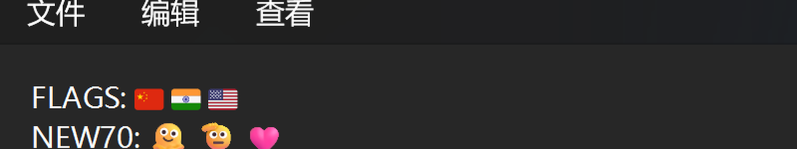
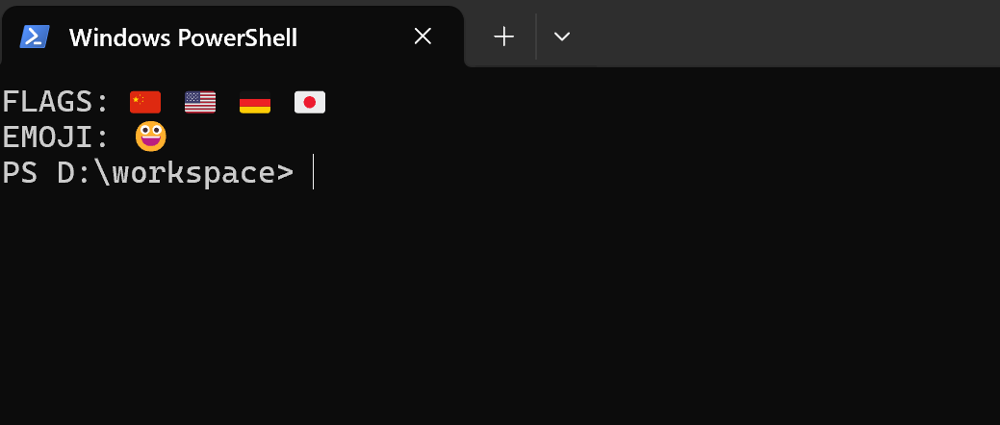
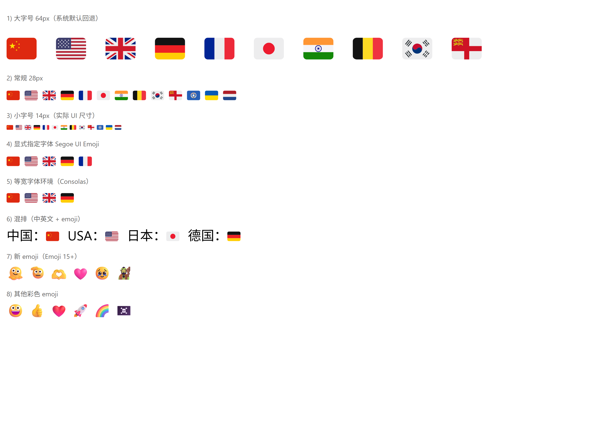
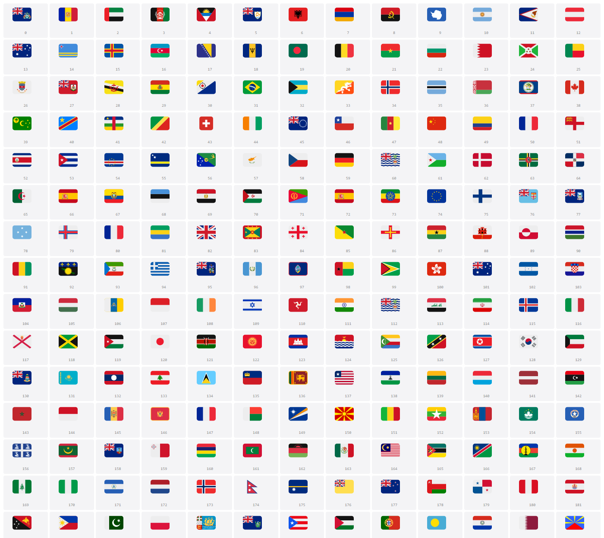

<div align="center">

# 🇨🇳 Windows 11 地区旗帜 Emoji

**让 Windows 显示完整彩色的地区旗帜 —— 浏览器、开始菜单、文件管理器都正常。**

[](#)
[](#)
[](#)
[](#)

</div>

---

## 问题

Windows 自带的 emoji 字体不含地区旗帜。输入 `🇨🇳` 只会显示成字母 **CN**，
输入 `🇺🇸` 显示成 **US**。

安装本项目的字体后，259 面地区旗帜都能正常显示。

> ⚠️ **本项目是纯技术项目，不对任何旗帜作政治表态。**
> 字体中的旗帜集合完全遵循 Unicode 标准，详见 [政治免责声明](#️-政治免责声明)。

---

## 使用方法

### 第一步：安装

双击 **`启动.cmd`**，会弹出菜单：

```
  Windows 11 地区旗帜 Emoji 修复工具
=========================================

  当前生效: seguiemj.ttf
  原版备份: 已存在 (12,934,920 字节)

-----------------------------------------
   [1] 安装修复版字体
   [2] 还原系统原版字体
   [3] 查看当前状态
   [0] 退出
-----------------------------------------

请输入选项 (1/2/3/0)
```

输入 **1** 回车，然后按提示授予管理员权限。

### 第二步：重启

安装完成后会询问是否重启，选 **Y** 即可。

> 字体缓存需要重启才会刷新。重启前开始菜单和文件管理器不会变化。

### 第三步：检查

重启后随便打开一个输入框，输入 `🇨🇳 🇺🇸 🇯🇵`，应该能看到彩色地区旗帜。

### 如果想撤销

再次双击 `启动.cmd`，选 **2**（还原系统原版），然后重启。

> 第一次安装时会自动把原版字体备份到 `backup/`，还原就是用那个备份写回去。
> **请注意不要删除 `backup/` 目录**，否则无法自动还原。

---

## 改了哪些地方

### 1. 补上了 71 个缺失的新 emoji

Windows 11 支持 Emoji 15.1，但很多第三方字体只做到 13.1。
本项目保留系统原版的全部 emoji，所以这些新字符不会变成方框：

🫠 融化脸　🫡 敬礼　🫶 爱心手　🩷 粉心　🥹 强忍泪水　🪿 鹅　🧌 巨魔　🪷 莲花

### 2. 修正了中国国旗

部分方案里的 🇨🇳 是用几条色带拼出来的杂色旗（红蓝白黑横条）。
本项目是**红底 + 五颗五角星**，和真实的五星红旗一致。

### 3. 补上了萨克岛旗

很多方案只有 258 面旗，缺 🇨🇶（萨克岛），输入时显示成字母 **CQ**。
本项目补齐到 **259 面**。

### 4. 开始菜单和文件管理器也能显示

这是最主要的改进。其他方案通常只修好了浏览器，
在开始菜单、文件管理器里地区旗帜会变成线稿或者干脆空白。
本项目让这些地方也能正常显示。详见下方「适用环境」。

---

## 适用环境

| 环境 | 效果 |
|---|:---:|
| Chrome / Edge 浏览器 | 🌈 彩色 |
| 记事本 | 🌈 彩色 |
| Windows Terminal | 🌈 彩色 |
| PowerShell（传统窗口） | 🌈 彩色 |
| 开始菜单搜索框 | 🌈 彩色 |
| 文件管理器列表 | ⬛ 单色 |
| WPF 应用 | ⬛ 单色 |

**为什么有两种效果**

浏览器、记事本这类程序支持彩色字体，地区旗帜是彩色的，和图片一致。

文件管理器和 WPF 应用不支持彩色字体 —— 这是 Windows 本身的限制，
系统自带的 emoji 在那些地方也是黑白的。本项目保证它们至少能画出
地区旗帜的轮廓，而不是一片空白。

> 相比之下，一些同类方案在开始菜单和文件管理器里会显示成**线稿**或**完全空白**。

---

## 效果预览

**记事本**



**传统 PowerShell**



**浏览器（多种字号、中英混排、新 emoji）**



<details>
<summary><b>展开查看全部 259 面地区旗帜</b></summary>



</details>

---

## ⚠️ 政治免责声明

本项目是一个**纯技术项目**，目的是修复 Windows 字体缺少地区旗帜字形的问题。

### 关于旗帜图形

字体中的地区旗帜图形来自 [Twemoji](https://github.com/jdecked/twemoji) 开源 emoji 集，
其设计参照 Unicode 标准中的**区域指示符（Regional Indicator）**编码规范。

**本项目不表达、也不代表任何政治立场**，包括但不限于：

- 不对任何国家、地区、政权的主权归属、合法性、领土范围作出判断
- 不对任何争议地区的归属表明态度
- 不认可或反对任何政治实体

### 关于旗帜的取舍

字体包含的旗帜集合**完全遵循 Unicode 标准**中已定义的区域指示符组合，
并未经过任何政治筛选。之所以包含某个旗帜，仅仅是因为 Unicode 为其分配了码位。

因此，字体中出现的某些旗帜可能：

- 与部分国家/地区的官方立场不一致
- 涉及存在主权争议的地区
- 对应非联合国会员的政治实体
- 存在不同称谓（同一地区不同语言/立场下的名称不同）

**这些都不代表本项目或其作者的任何倾向。**

### 使用建议

如果你所在的地区对特定旗帜有法律规定或使用限制，请自行判断是否使用本项目。
因使用本项目产生的任何后果，作者不承担责任。

### 关于命名

本项目在文档和代码中**不对任何地区使用特定政治称谓**，
仅以 Unicode 码位（如 U+1F1E8 U+1F1F3）或中性描述（如「旗帜」「地区」）指代。

如你认为某个旗帜的出现本身构成问题，欢迎通过 Issue 讨论，
但请理解：**移除某一面旗帜意味着偏离 Unicode 标准**，这会破坏字体的一致性和可用性。

---

## 常见问题

<details>
<summary><b>装完了还是显示 CN / 方框？</b></summary>

需要重启。字体缓存在重启时才刷新，重启前开始菜单、文件管理器不会变化。
</details>

<details>
<summary><b>安装时提示「文件正被系统占用」？</b></summary>

字体正被系统锁定。重启电脑后再运行一次即可，备份已经做好了，不会丢。
</details>

<details>
<summary><b>文件管理器里是黑色的？</b></summary>

文件管理器和 WPF 应用不支持彩色字体，这是 Windows 的限制。
在这些地方地区旗帜会显示为单色图案 —— 用系统自带的 emoji 也是黑白的。
</details>

<details>
<summary><b>怎么确认装好了？</b></summary>

双击 `启动.cmd` 选 3，能看到：

```
  当前生效: segoeemj.ttf
  原版备份: 已存在 (12,934,920 字节)
  [OK] 补丁唯一: segoeemj.ttf
  [OK] 系统原版存在: seguiemj.ttf
```

另外可以双击 `emoji-test.html`，页面上能查看全部 emoji 和地区旗帜，
还能搜索码位、调字号。
</details>

<details>
<summary><b>会占用多少空间？</b></summary>

字体本身 5.8MB，加上原版备份约 19MB。
</details>

---

## 文件说明

```
启动.cmd                      双击运行（弹出菜单）
flag-fix.ps1                  主脚本
emoji-test.html               全 emoji 测试页
core/segoeemj_patched.ttf     修复版字体
backup/seguiemj_original.ttf  自动备份的原版（勿删）
docs/                         截图
```

最高级用法（脚本调用）：

```powershell
.\flag-fix.ps1                    # 交互菜单
.\flag-fix.ps1 install            # 直接安装
.\flag-fix.ps1 install -NoRestart # 装但不自动重启
.\flag-fix.ps1 restore            # 还原
.\flag-fix.ps1 diagnose           # 诊断
```

---

## 致谢

本项目的思路和素材来自以下工作：

<table>
<tr><th width="190">项目</th><th>贡献</th></tr>
<tr><td><a href="https://llccd.eu.org/2022/02/win_flags/"><b>llccd</b></a></td><td>核心思路：向 Segoe UI Emoji 注入地区旗帜字形。</td></tr>
<tr><td><a href="https://github.com/jdecked/twemoji"><b>Twemoji</b></a></td><td>259 面地区旗帜的矢量图形与配色（CC-BY 4.0）。</td></tr>
<tr><td><a href="https://github.com/tuannvbg/unicode-flags-for-windows"><b>tuannvbg</b></a></td><td>Windows 10/11 地区旗帜修复的完整实践。</td></tr>
<tr><td><a href="https://github.com/Chasmical/flag-emojis-for-windows"><b>Chasmical</b></a></td><td>地区旗帜字体方案的重要参考。</td></tr>
<tr><td><a href="https://github.com/fonttools/fonttools"><b>fontTools</b></a></td><td>字体解析与修改工具（MIT）。</td></tr>
<tr><td><b>Microsoft</b></td><td>Segoe UI Emoji 字体本身（版权归 Microsoft）。</td></tr>
</table>

本项目只分发修复版字体，不含系统原版 —— 原版会在安装时从你的系统自动备份。

---

<div align="center">

**如果这个项目帮到了你，不妨点个 ⭐**

</div>